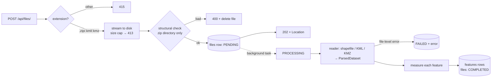

# Geospatial File Measurement API

A FastAPI service that accepts a geospatial file — a **zipped Shapefile**, a **KML** or a **KMZ** —
extracts every feature (index/ID, geometry type, geometry, CRS, attributes) and returns
**area** for polygons and **length** for lines, in metres, computed correctly regardless of the
file's coordinate reference system.

```
POST /api/files/                     upload a .zip (Shapefile), .kml or .kmz
GET  /api/files/{id}/                file info + processing status
GET  /api/files/{id}/measurements/   per-feature area / length (+ summary)
GET  /api/files/{id}/features/       parsed features as GeoJSON
```

**Highlights**

- Measurements never use degrees: every feature is projected to an **equal-area projection
  centred on that feature** before measuring. Each result also carries an independent
  **geodesic** (ellipsoidal) value as a cross-check; on the samples the two agree to < 0.00001%.
- Any source CRS is handled, including projected ones that distort area (e.g. Web Mercator,
  where a naive calculation at 60°N is **4× too large**).
- One bad feature never fails a file — unsupported, empty, invalid or unparseable geometries
  are reported per feature with a status and a reason.
- Hardened input handling: size limits, zip-bomb and zip-slip protection, XML entity-expansion
  protection, filename sanitisation.
- 62 tests (pytest), GitHub Actions CI on Python 3.10–3.12, Dockerfile.

---

## Setup

Requires Python 3.10+ (3.10.0 exactly is not supported by current pydantic — use 3.10.1+).
No system GIS libraries are needed: `shapely` and `pyproj` wheels bundle GEOS and PROJ.

```bash
python -m venv .venv
source .venv/bin/activate            # Windows: .venv\Scripts\activate
pip install -r requirements-dev.txt
uvicorn app.main:app --reload
```

Open <http://localhost:8000/docs> for the interactive Swagger UI.

**Docker**

```bash
docker build -t geo-measurement-api .
docker run -p 8000:8000 -v geo-data:/data geo-measurement-api
```

**Tests**

```bash
pytest -q
```

**Configuration** (environment variables, all optional)

| Variable | Default | Purpose |
|---|---|---|
| `GEO_DATA_DIR` | `./data` | Uploaded files and the SQLite database |
| `DATABASE_URL` | `sqlite:///$GEO_DATA_DIR/app.db` | Any SQLAlchemy URL (e.g. PostgreSQL) |
| `GEO_MAX_UPLOAD_BYTES` | 50 MB | Max upload size |
| `GEO_MAX_UNCOMPRESSED_BYTES` | 200 MB | Max expanded size of a .zip/.kmz |
| `GEO_MAX_ARCHIVE_MEMBERS` | 1000 | Max entries in a .zip/.kmz |

---

## API

Sample files are in [`samples/`](samples/) (regenerate with `python scripts/make_samples.py`):
`quarry_survey.kml` (a pit polygon with a hole, a haul road and two control points, WGS84) and
`stockpiles_utm43n.zip` (three stockpile footprints, UTM zone 43N).

### `POST /api/files/` — upload

Multipart form field `file`. Accepted: `.zip` containing one Shapefile (`.shp` + `.shx` + `.dbf`,
optional `.prj` / `.cpg`; sub-folders fine), `.kml`, `.kmz`.

```bash
curl -i -F "file=@samples/quarry_survey.kml" http://localhost:8000/api/files/
```

```http
HTTP/1.1 202 Accepted
location: /api/files/265b7d25637f4bd9b1205feccc689fd5/
```
```json
{
  "id": "265b7d25637f4bd9b1205feccc689fd5",
  "filename": "quarry_survey.kml",
  "file_format": "kml",
  "size_bytes": 1412,
  "status": "PENDING",
  "feature_count": null,
  "crs": null,
  "crs_name": null,
  "warnings": [],
  "error": null,
  "created_at": "2026-10-10T09:12:49.345664Z",
  "processed_at": null
}
```

Cheap structural problems are rejected immediately so the client gets a direct answer:

| Status | When |
|---|---|
| `400` | Empty file; not a valid zip; zip has no `.shp`, several `.shp`, missing `.shx`/`.dbf`; unsafe paths; archive too large when expanded |
| `413` | Upload exceeds `GEO_MAX_UPLOAD_BYTES` |
| `415` | Extension is not `.zip`, `.kml` or `.kmz` |

Parsing and measuring then run in a background task (`PENDING → PROCESSING → COMPLETED | FAILED`).

### `GET /api/files/{id}/` — file information

```json
{
  "id": "265b7d25637f4bd9b1205feccc689fd5",
  "filename": "quarry_survey.kml",
  "file_format": "kml",
  "size_bytes": 1412,
  "status": "COMPLETED",
  "feature_count": 4,
  "crs": "EPSG:4326",
  "crs_name": "WGS 84",
  "warnings": [],
  "error": null,
  "created_at": "2026-10-10T09:12:49.345664Z",
  "processed_at": "2026-10-10T09:12:49.455095Z"
}
```

`warnings` carries file-level caveats (e.g. *"No .prj file; coordinates look like
longitude/latitude so EPSG:4326 was assumed."*). `error` explains a `FAILED` status
(e.g. *"KML is not well-formed XML: …"*).

### `GET /api/files/{id}/measurements/` — measurements

Query: `limit` (1–1000, default 100), `offset`. The `summary` always covers the whole file.

```json
{
  "file_id": "265b7d25637f4bd9b1205feccc689fd5",
  "crs": "EPSG:4326",
  "units": { "area": "m2", "length": "m" },
  "summary": {
    "feature_count": 4, "measured": 2, "not_applicable": 2,
    "unsupported": 0, "skipped": 0, "errors": 0,
    "total_area_m2": 864210.3770613638,
    "total_length_m": 2135.2812538275302
  },
  "limit": 100,
  "offset": 0,
  "measurements": [
    {
      "feature_index": 0,
      "source_id": "pit-boundary",
      "geometry_type": "Polygon",
      "status": "measured",
      "area_m2": 864210.3770613638,
      "perimeter_m": 5259.026171409178,
      "length_m": null,
      "measurement_crs": "+proj=laea +lat_0=12.974500 +lon_0=77.594500 +x_0=0 +y_0=0 +datum=WGS84 +units=m +no_defs +type=crs",
      "geodesic_area_m2": 864210.3799475431,
      "geodesic_length_m": null,
      "note": null
    },
    {
      "feature_index": 1,
      "source_id": "haul-road",
      "geometry_type": "LineString",
      "status": "measured",
      "length_m": 2135.2812538275302,
      "geodesic_length_m": 2135.2812529427874,
      "measurement_crs": "+proj=laea +lat_0=12.965113 +lon_0=77.582407 …",
      "…": "…"
    },
    {
      "feature_index": 2,
      "source_id": "gcp-1",
      "geometry_type": "Point",
      "status": "not_applicable",
      "note": "Points have no area or length.",
      "…": "…"
    }
  ]
}
```

Per-feature `status`:

| status | Meaning |
|---|---|
| `measured` | Polygon/MultiPolygon → `area_m2` + `perimeter_m`; LineString/MultiLineString → `length_m` |
| `not_applicable` | Point/MultiPoint — nothing to measure |
| `unsupported` | e.g. a mixed `GeometryCollection` (KML `MultiGeometry` with points and lines) |
| `skipped` | No usable geometry: null shape, Placemark without geometry, `gx:Track`, unparseable coordinates (`note` says which) |
| `error` | Measurement attempted but impossible, e.g. CRS unknown or coordinates outside the CRS's valid range |

Returns `409` if the file is still processing or processing failed, `404` for an unknown id.

### `GET /api/files/{id}/features/` — features as GeoJSON

A `FeatureCollection` with geometries **in the file's own CRS** (named in `crs`) and the
original attributes, plus `_source_id` / `_geometry_type`. Same `limit` / `offset` paging.

### Also

`GET /api/files/` (list, newest first, paged) · `DELETE /api/files/{id}/` (removes the record,
its features and the stored upload; `409` while processing) · `GET /health`.

---

## Architecture

```
app/
├── main.py              app factory, lifespan (create tables, fail jobs interrupted by a restart)
├── config.py            settings from environment variables
├── db.py / models.py    SQLAlchemy engine/session; UploadedFile 1─* Feature
├── schemas.py           pydantic response models (the API contract)
├── api/files.py         HTTP layer: validation, status codes, pagination
├── services/
│   ├── storage.py       streaming upload to disk with size cap, filename sanitising
│   └── processing.py    background job: read → measure → persist, status transitions
└── geo/                 pure geospatial logic — no FastAPI/HTTP knowledge
    ├── __init__.py      read_dataset(): dispatch by format
    ├── archive.py       safe zip access (limits, zip-slip, macOS junk)
    ├── shapefile_reader.py
    ├── kml_reader.py    KML + KMZ
    ├── crs.py           CRS description, projection choice, reprojection
    └── measure.py       per-feature measurement, never raises
```

The `geo` package returns plain dataclasses (`ParsedDataset`, `ParsedFeature`,
`MeasurementResult`), so it is unit-tested without HTTP or a database, and could be reused
from a worker, a CLI or a notebook unchanged.

### File-processing flow



1. **Upload** — the file is streamed to `data/uploads/<id>/` in 1 MB chunks and rejected once it
   exceeds the size limit (never buffered whole in memory).
2. **Structural check (sync)** — for `.zip`/`.kmz` only the central directory is read: member
   count, total expanded size, path safety, exactly one `.shp` with its `.shx`/`.dbf`.
3. **Read (background)** — archive members are read into memory (never extracted to disk);
   - *Shapefile*: `pyshp` reads geometry + attributes; `.prj` → `pyproj.CRS`; `.cpg` → attribute
     encoding. Attribute values are made JSON-safe (dates → ISO strings, NaN → null).
   - *KML/KMZ*: parsed with `defusedxml`, namespace-agnostic; walks nested `Folder`s, reads
     `name`, `description`, `ExtendedData` (`Data` and `SchemaData`), supports `Point`,
     `LineString`, `LinearRing`, `Polygon` (with holes), `MultiGeometry`.
4. **Measure** each feature (below) and persist one `features` row per feature, including
   features that could not be parsed or measured — the client sees every feature and why.
5. **Status** becomes `COMPLETED`, or `FAILED` with a message if the file itself is unreadable.

### Measurement-calculation flow

```
geometry (source CRS)
  │  null/empty → skipped · Point → not_applicable · other non-line/polygon → unsupported
  │  unknown CRS → error
  ▼
force 2D; invalid polygon → shapely.make_valid (keep areal parts, add a note)
  ▼
reproject to WGS84 lon/lat  (densify edges first if the feature is wider than ~11 km)
  ▼
choose measurement CRS: Lambert Azimuthal Equal-Area centred on the feature's centroid
  ▼
reproject → planar area / perimeter / length in metres
  +
geodesic area / length on the WGS84 ellipsoid (pyproj.Geod) as an independent check
```

Every step is wrapped so an exception becomes `status: error` with a `note` for that feature only.

### CRS handling

- **KML/KMZ** are always WGS84 lon/lat (EPSG:4326) by the OGC KML spec.
- **Shapefiles** use the `.prj` (ESRI WKT, parsed by `pyproj`). If it is missing and every
  coordinate is within ±180/±90 we assume EPSG:4326 and say so in `warnings`; otherwise the CRS is
  `null` and features are reported as `error` rather than measured on a guess.
- The response gives the source CRS as an authority code (`EPSG:32643`) plus its name.
- For measurement, every geometry is first transformed to WGS84 lon/lat — **even if the source is
  already projected** — and then into a per-feature **Lambert Azimuthal Equal-Area (LAEA)**
  projection centred on the feature. Area is measured there, never in degrees.
- `measurement_crs` in the response records exactly which projection was used.

---

## Design decisions

**Per-feature equal-area projection instead of UTM.** UTM was my first choice: it is the
industry standard and gives a recognisable EPSG code. But UTM is *conformal*, not *equal-area*:
its scale factor runs from 0.9996 on the central meridian to ~1.001 at zone edges, so areas are
off by up to ~0.2%. Measured on the samples: Stockpile B is 9,600.00 m² on the UTM 43N grid but
9,588.94 m² on the ground (0.12%), and a Bengaluru parcel measured in UTM 43N came out 0.12% too
large against the geodesic reference. UTM also needs special handling for features that cross
zones and is undefined beyond 84°N/80°S. LAEA centred on the feature is equal-area by
construction (area exact anywhere, any size) and its length distortion grows only with the square
of the distance from the centre (< 0.001% within ~50 km). The cost: `measurement_crs` is a PROJ
string rather than an EPSG code.

*Alternatives considered:* a single global equal-area CRS (e.g. EPSG:6933) — exact area, but
large length distortion away from its standard parallels; pure geodesic calculation with
`pyproj.Geod` — exact on the ellipsoid but doesn't satisfy the brief's "transform to a projected
CRS", so it is reported alongside as `geodesic_*` for verification.

**Always go through WGS84, even for projected sources.** Measuring directly in a projected source
CRS is only right if that CRS is locally accurate. Web Mercator (EPSG:3857) is common in exports
from web maps and inflates area by 1/cos²(lat) — 4× at 60°N (covered by a test). Re-projecting
everything is one consistent path, and for a UTM source it is a lossless round trip.

**Densify long edges.** A straight edge in the source CRS is a curve in any other CRS, so for
large features (> ~0.1°) edges are densified in the source CRS before reprojection. Small
features — the normal drone-survey case — skip this, so there's no cost for them.

**Background processing with `BackgroundTasks` + status field.** Upload returns `202` quickly;
the spec's `status` field implies asynchronous processing. `BackgroundTasks` keeps the setup to
one process with no broker. Its weakness is durability — work is lost if the process dies — so on
startup any `PENDING`/`PROCESSING` file is marked `FAILED` with a clear message instead of hanging
forever. A Celery/RQ worker is the next step (see Future scope).

**Fail fast on structure, fail per-feature on content.** Problems knowable from the zip directory
alone get a synchronous `400`, so a client uploading the wrong zip learns immediately. Inside a
valid file, bad features are recorded individually; only an unreadable file is `FAILED`.

**Pure-Python readers (`pyshp`, `defusedxml`) instead of GDAL/Fiona/GeoPandas.** GDAL is the most
capable option but brings a heavy native dependency that is often painful to install (especially
on Windows) and in slim containers. For exactly two formats, `pyshp` + a small KML parser keep
`pip install` dependency-free and the Docker image small, and give full control over error
reporting per feature. If many more formats were needed, switching the reader layer to
`pyogrio`/GDAL would be the right call — the `ParsedDataset` interface isolates that change.

**Store results, not just compute on request.** Features and measurements are persisted, so the
GET endpoints are cheap, paged reads and the file is processed exactly once. SQLite by default
(zero setup); any SQLAlchemy URL works, and only portable column types are used.

**Never trust the archive.** Members are read in memory instead of extracted (no zip-slip
writes), sizes are checked against the central directory before decompressing, the client's
filename is reduced to a safe basename, and KML is parsed with DTDs forbidden.

---

## Testing

`pytest -q` runs 62 tests in a few seconds:

- **`test_measure.py`** — correctness against independent geodesic values: WGS84 polygons and
  lines, a UTM source, Web Mercator, a 10°×10° polygon, a polar polygon (> 84°N), holes,
  multipolygons, bow-tie repair, points/empty/collections, unknown CRS, out-of-range coordinates.
- **`test_readers.py`** — KML nesting, attributes, holes, MultiGeometry, unsupported/broken
  geometries, malformed XML, entity-expansion attack; KMZ; shapefile `.prj`/no-`.prj`, null shapes,
  date attributes, sub-folders and `__MACOSX` junk, missing components, several shapefiles,
  zip-slip, corrupt `.shp`, size limits.
- **`test_api.py`** — the full HTTP flow, response shapes, pagination, rejections
  (400/404/409/413/415), failed processing, delete, path-traversal filenames, and recovery
  after a restart.

Fixtures are built in memory with `pyshp` and small KML strings, so the tests document exactly
what input produces what output.

---

## Limitations

- One shapefile per zip (multiple layers are rejected with a clear message).
- Features crossing the antimeridian (±180°) are not specially handled.
- KML `gx:Track`, `Model`, and 3D/vertical measurement are out of scope; altitudes are dropped
  (all measurements are planimetric). Shapefile `MultiPatch` is reported as unparseable.
- Processing runs in the API process; very large files would hold a worker thread.

## What I learned

- Picking "a projected CRS" is not enough on its own: UTM is conformal, not equal-area, and the
  ~0.1% error only showed up once I compared against an independent geodesic calculation. Building
  that cross-check into both the tests and the API response was the most useful decision in the
  project.
- "Straight line" depends on the CRS — reprojecting only vertices bends edges for large features.
- Real-world inputs are messy (missing `.prj`, macOS resource forks in zips, invalid self-
  intersecting polygons, mixed KML MultiGeometries), so a per-feature status model ended up more
  important than the happy path.

## Future scope

- Durable job queue (Celery/RQ + Redis) with retries, and object storage (S3) for uploads.
- More formats via GDAL/`pyogrio`: GeoJSON, GeoPackage, multi-layer shapefile zips, DXF.
- Optional output units (hectares, acres, km) and a choice of measurement method
  (`projected` | `geodesic`).
- Return geometries reprojected to a requested CRS (`?crs=EPSG:4326`), and a bounding box per
  file for map previews.
- 3D measurements (surface area, volume from DEMs) — the natural next step for drone survey data.
- Auth, per-user file ownership, rate limiting, and PostgreSQL/PostGIS with Alembic migrations.
